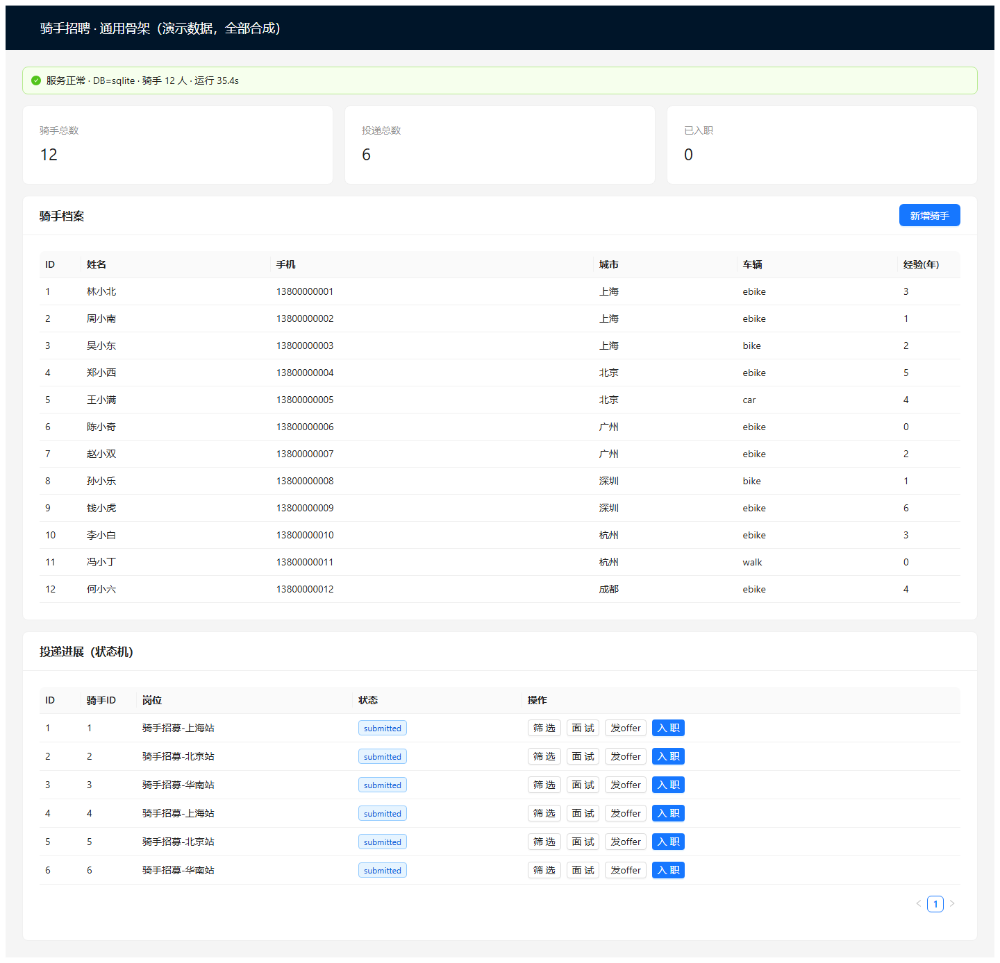

# 骑手招聘管理 · 可运行骨架（合成数据演示）

一个能真正跑起来的招聘后台演示：骑手档案增删查、工号（手机号）唯一、重复登记直接返回 `409`。不是方案文档，是能按下面命令复跑的服务。

**冒烟 7/7 通过** · FastAPI + SQLite · 前端已打包，开箱即看 · 全部合成数据

> 在线说明页（第三方 CDN 渲染）：https://raw.githack.com/AWKN-Lab/rider-hiring-demo/main/index.html
> 本仓库页面为同一内容的 Markdown 版，作为长期可用的主链接。

## 一、解决什么问题

招聘专员每天要手工登记骑手：姓名、手机号、城市、车辆类型、经验年限。手工登记最常出的两个错是**重复录入**和**状态乱跳**（还没面试就被标成已入职）。

- **档案管理**：列表分页、查询、新增、删除。
- **工号唯一**：以手机号作为唯一键，重复登记返回 `409 Conflict`，不会产生脏数据。
- **投递状态机**：`submitted → screening → interview → offered → hired`，非法跳转（如 `screening → hired`）直接 409。

## 二、能跑的证据

### 1）界面实拍（本地真实运行，非设计稿）



截图取自 `uvicorn app.main:app --port 8090` 启动后的真实页面，数据为种子合成数据（12 名骑手、6 条投递）。

### 2）冒烟脚本实测输出（7/7 PASS）

```text
PASS  GET /api/health                              http=200 db=sqlite
PASS  GET /api/v1/riders                           http=200 total=15 page=5
PASS  POST /api/v1/riders                          http=201 id=16 phone=13993797225
PASS  POST /api/v1/applications                    http=201 id=8 status=submitted
PASS  POST /api/v1/applications/{id}/transition    http=200 status=screening
PASS  POST /transition illegal (screening->hired)  http=409 illegal transition
PASS  GET /openapi.json                            http=200

SMOKE PASS 7/7
```

复跑命令：`python tests/smoke_e2e.py --base http://127.0.0.1:8090`

### 3）三个核心接口的真实返回

```text
GET /api/health
{"status":"ok","db":"sqlite","riders":12,"time_utc":"2026-11-04T13:00:44+00:00"}

GET /api/v1/riders
{"items":[{"id":1,"name":"林小北","phone":"13800000001","city":"上海",
          "vehicle":"ebike","years_experience":3,"note":"合成数据-演示用"}],
 "total":12,"limit":20,"offset":0}

POST /api/v1/riders   （同一手机号第二次提交）
HTTP 409
{"detail":"phone 13900000001 already exists"}
```

## 三、怎么自己跑起来

```bash
# 1. 装依赖
cd back && pip install -r requirements.txt

# 2. 启动服务
uvicorn app.main:app --port 8090

# 3. 浏览器打开
# http://127.0.0.1:8090
```

前端已在 `front/dist` 打包好，后端启动后直接托管，不需要再装 Node。接口文档：`http://127.0.0.1:8090/docs`。

## 四、数据声明与边界

**数据声明**：页面与接口里的姓名、手机号、城市全部为合成数据（`13800000001` 这类连号），不含任何真实个人信息，不对接任何真实骑手库。

**明确不做**：

- 不做真实支付、结算、工资代发；
- 不接真实骑手库、不做实名认证与背调；
- 不做多租户、不做权限体系（演示用单管理员）；
- 不做生产级高可用与数据备份策略。

如果需求包含上述任一项，说明这套骨架只覆盖了「档案 + 状态机」那一半，另一半需要单独评估与排期。

## 五、下载完整源码

包含后端（FastAPI + SQLite + 状态机）、前端源码与已打包产物、冒烟脚本、Dockerfile 与 docker-compose、交付说明。已剔除本地数据库与缓存。

**下载**：[rider-hiring-skeleton-20261104.zip](https://github.com/AWKN-Lab/rider-hiring-demo/releases/download/v1.0.0/rider-hiring-skeleton-20261104.zip)（348 KB）

**SHA-256**：`5b34553a22b16de195fd1e4c776f658cef7c3db57487880db8a0b44b89eb8daf`

## 六、工期与验收

- **工期**：同类需求（骑手 / 招聘 / 后台档案管理）在确认验收口径后 **3 个工作日**内按需求裁剪交付；当前这套骨架开箱即可运行。
- **验收方式**：按接口清单逐条复跑，再执行 `python tests/smoke_e2e.py --base http://127.0.0.1:8090`，期望 7/7 PASS；状态机非法跳转必须返回 409。

---

技术栈：FastAPI · SQLite · 原生前端（已打包）｜运行环境：Python 3.9+，单机即可｜本页不含任何账号、密钥或内部地址。
